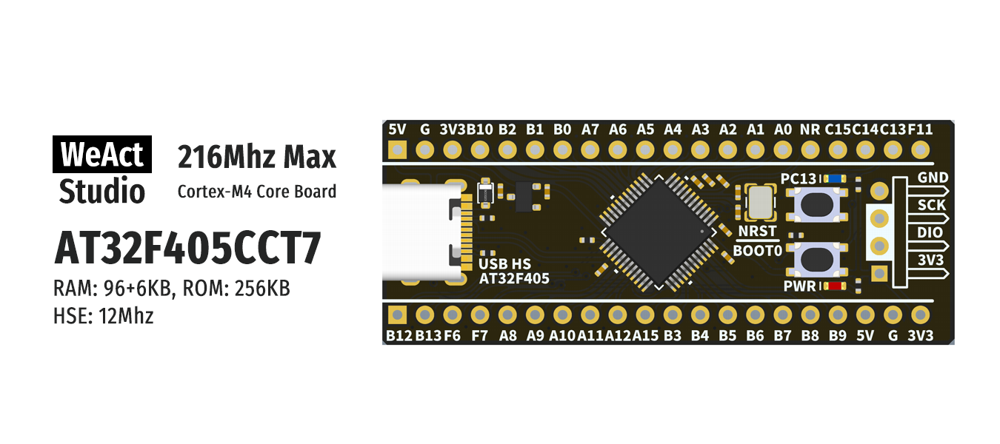

* [中文版本](./README_zh.md)
# WeActStudio.AT32F405_48Pin_CoreBoard

AT32F405CCT7
> 216Mhz Max, 96+6KB RAM, 256KB ROM

Arterytek Official Website www.arterytek.com

|Dir Name|Explain|
| :--:|:--:|
|Doc|DataSheet/ReferenceManual|
|Hardware|Hardware Development Kit|
|Examples|Software Examples|

```
/*---------------------------------------
- WeAct Studio Official Link
- taobao: WeActStudio.taobao.com
- aliexpress 1: WeActStudio.aliexpress.com
- aliexpress 2: WeActStudioOne.aliexpress.com
- github: github.com/WeActStudio
- gitee: gitee.com/WeActStudio
- blog: blog.weactstudio.com
---------------------------------------*/
```
