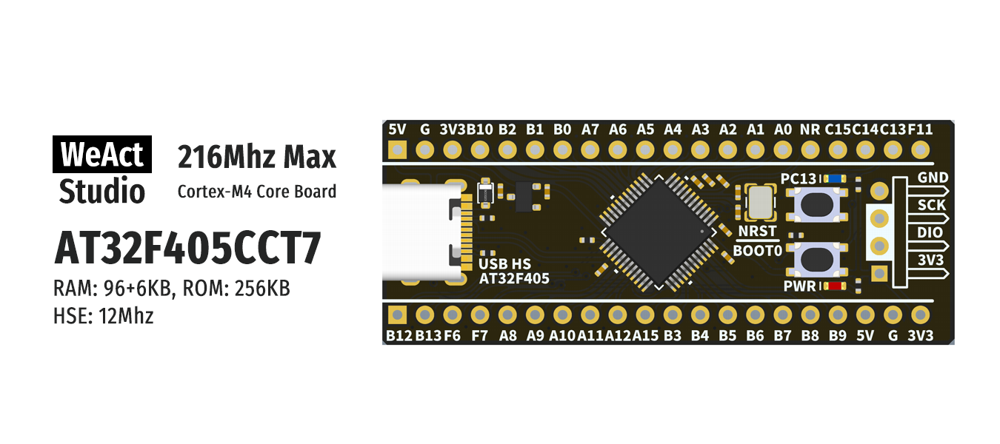

* [English version](./README.md)
# WeActStudio.AT32F405_48Pin_CoreBoard

AT32F405CCT7
> 216Mhz Max, 96+6KB RAM, 256KB ROM

雅特力 官方网站 www.arterytek.com

|目录名称|内容|
| :--:|:--:|
|Doc| 数据手册/参考手册|
|Hardware| 硬件开发资料|
|Examples|软件例程|

```
/*---------------------------------------
- WeAct Studio Official Link
- taobao: WeActStudio.taobao.com
- aliexpress 1: WeActStudio.aliexpress.com
- aliexpress 2: WeActStudioOne.aliexpress.com
- github: github.com/WeActStudio
- gitee: gitee.com/WeAct-TC
- blog: www.weact-tc.cn
---------------------------------------*/
```